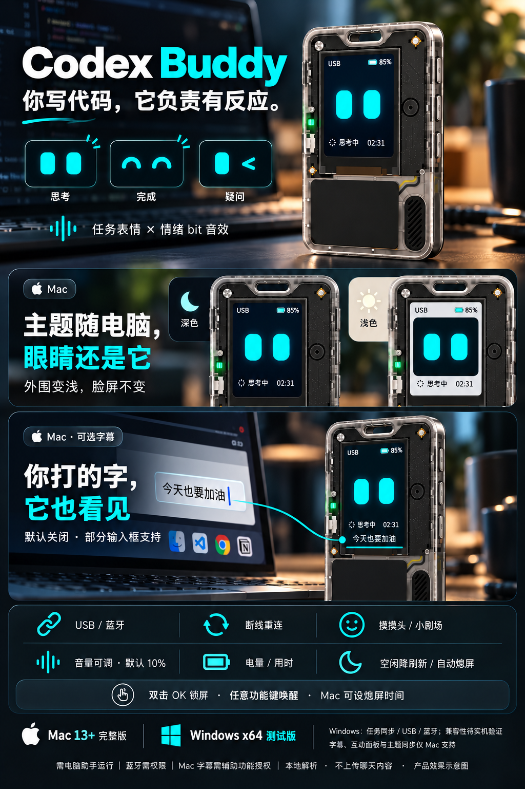

[简体中文](README.zh_CN.md) · **English**

# Codex Buddy

A coding companion for the FoloToy AI Passport. Your local Codex activity becomes expressive cyan eyes and playful bit sounds on a real desk-side device.

## What it does

- Task expressions, animated gaze and emotion-specific bit sounds.
- USB or BLE synchronization, USB priority and automatic reconnection.
- Battery level, task status and elapsed time on the device.
- Adjustable volume (10% default), mute, idle refresh reduction and automatic screen-off.
- Double-press OK to lock the screen; any function key wakes it.
- On Mac: greetings, petting and little skits; optional input captions and text reactions; system appearance synchronization around the permanently dark face; configurable screen-off timeout.

| Platform | Status |
| --- | --- |
| macOS 13+, Apple Silicon / Intel | Main desktop assistant. Captions are optional and only work in supported input fields. |
| Windows x64 | **Test version.** Task sync, USB and BLE are implemented; real Windows connection compatibility is still being verified. No captions, interaction panel or theme sync. |

## Get started

Install the Codex Buddy firmware on an AI Passport, run the desktop assistant on the same computer as Codex, and connect over USB or BLE. The assistant must remain running. BLE connects from the assistant without prior system pairing; the device accepts one BLE computer connection at a time.

There are no downloadable releases in the initial source publication. Build from source using the guides below. The included firmware uses the same protocol as the Windows assistant; switching computers does not require reflashing compatible Codex Buddy firmware.

## Build and documentation

| Part | Guide | Build / test |
| --- | --- | --- |
| AI Passport firmware | [Buddy guide](firmware/docs/CODEX_BUDDY.md) · [Environment](firmware/docs/development/engineering/environment-setup.md) | Activate ESP-IDF 5.5.3, then run `./tools/validate.sh` inside `firmware/`. |
| Mac assistant | [Desktop guide](desktop/README.md) | `bash desktop/scripts/test.sh`, then `bash desktop/scripts/build.sh` on macOS with Xcode command-line tools. |
| Windows assistant | [Windows guide](desktop-windows/README.md) | With .NET 10 SDK on Windows, run `./scripts/build.ps1` inside `desktop-windows/`. |
| Community materials | [Short description](output/community/community-post.txt) · [Product poster](output/community/codex-buddy-poster-v4.png) | Illustrative product renders, not device screenshots. |

Mac builds use a local ad-hoc signature by default. Your private signing identity is not included; a stable local signing identity can be configured as described in the desktop guide. These builds are not Apple-notarized or commercially signed Windows installers.

## Permissions and privacy

- USB task synchronization does not require Accessibility access.
- Bluetooth access is needed only when using BLE.
- Mac input captions and text reactions are **off by default** and require Accessibility / device-control access. They do not work in every input field or guarantee live IME composition.
- No microphone, camera, Screen Recording or Input Monitoring access is required.
- The assistant parses local Codex session records. Task metadata is sent directly to the device; chat content is not uploaded to a server. Enabling captions sends rendered caption images to the device.

## License and credits

[MIT](LICENSE). The firmware baseline is derived from [FoloToy/ai-passport](https://github.com/FoloToy/ai-passport); its original [license](firmware/LICENSE) and notices are retained. Bundled Noto Sans SC font assets retain their [SIL Open Font License](firmware/assets/fonts/OFL.txt). Managed dependencies retain their own licenses and are fetched by the build tools.

This is an independent community project; product and company names belong to their respective owners.
